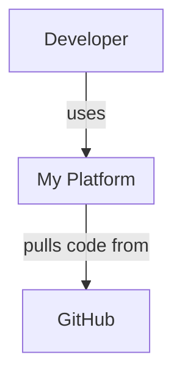
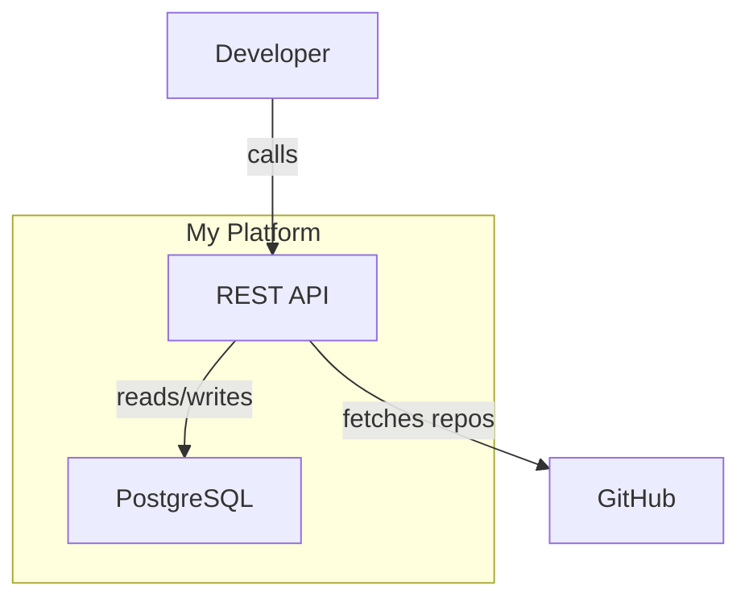
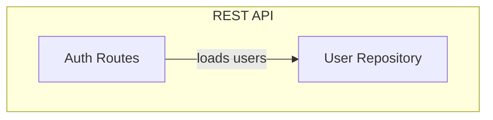

<!-- Generated by Decreen Local. Safe to regenerate if unchanged. decreen-template-version: 2026-06-beta-1 -->
---
name: decreen-preview
description: >-
  Create a temporary Decreen architecture preview from the current repository.
  Analyzes runtime structure, generates a concise C4-style Mermaid artifact,
  writes local provenance/evidence references, asks for confirmation when
  appropriate, uploads only the generated Mermaid artifact to Decreen, and
  returns an interactive viewer link. No Decreen signup or API token required
  for preview mode. Use when the user explicitly runs /decreen-preview or explicitly
  asks to create a Decreen preview link from the current repo.
disable-model-invocation: true
user-invocable: true
---

# Decreen Preview

Create a **temporary Decreen architecture preview** from the current repository.

This skill analyzes the repo, generates a concise C4-style Mermaid artifact, validates what will be uploaded, uploads only that generated architecture artifact to Decreen, writes local Decreen metadata, and returns an interactive viewer link.

No Decreen account or API token is required for preview mode.

The preview expires after 7 days unless claimed.

**Follow Step 0 throughout this skill** — including before upload and during analysis.

## Step 0: User-facing output contract

Before upload / during analysis, say only:

`Creating architecture preview…`

Do not narrate internal steps, tool choices, fallback attempts, API calls, curl commands, manifest checks, sidecar writes, environment detection, reading this skill, or diagnostics.

Required user confirmation prompts (Step 6) are allowed when safety validation requires them.

On success, use `formatPreviewProductSummary` or match [Successful output style](#successful-output-style) exactly.

On failure, partial success, or skipped upload:

- do not use the success template
- do not show the ASCII mark (including when `DECREEN_NO_ASCII=1`)
- give a short problem statement and the next action only
- include **Debug details** only when:
  - the preview could not be created
  - the user asks
  - `DECREEN_DEBUG=1`
  - `DECREEN_API` is not the production default

Do not tell the user that `/decreen-deepen` is available before claim.

---

## Quick path

```text
/decreen-preview → resolve repo → analyze (5 passes) → write .decreen/runs/*
→ validate → [confirm if required] → `decreen preview upload` → viewer link
```

To inspect existing local Decreen state without upload, use [`/decreen-status`](../decreen-status/SKILL.md).

---

## Privacy and upload scope

This skill sends a generated architecture artifact to Decreen. It does **not** upload source files.

**Uploaded to Decreen:**

* generated Mermaid architecture markdown
* the `## Containment Map` metadata embedded in that markdown
* repository metadata: repo name, branch, commit SHA, and sanitized remote URL when available

**Not uploaded:**

* source code files
* source file contents
* local evidence/provenance sidecar
* `.env` files
* secrets, tokens, credentials, private keys, or environment values
* raw dependency directories such as `node_modules`, `vendor`, `dist`, or build output

**Local-only files written:**

* `.decreen/runs/latest.upload.md`
* `.decreen/runs/latest.source-evidence.json`
* `.decreen/runs/latest.node-working-summaries.json`
* `.decreen/manifest.json`

The local evidence sidecar stores references to files, symbols, routes, and reasons. It must not contain source code bodies.

If the repository is private, sensitive, or proprietary, summarize the generated artifact and ask the user to confirm before upload (safety always overrides auto-upload shortcuts).

---

## When to use

**Use this skill when:**

* the user explicitly runs `/decreen-preview`
* the user explicitly asks to create a Decreen preview link
* the user explicitly asks to publish a temporary architecture preview to Decreen

**Do not use this skill for:**

* local-only architecture diagrams with no Decreen upload
* general architecture Q&A without an upload request
* code review
* Mermaid files for docs only (no Decreen preview)
* private analysis where the user has not agreed to upload a preview
* persistent workspace refreshes after claim

For persistent claimed workspaces, use `/decreen-update`, `/decreen-deepen`, or `@decreen/local@beta` workflows instead.

---

## Flow

```text
1. Resolve repository context
2. Analyze repo runtime architecture
3. Generate one Mermaid markdown upload artifact
4. Generate local source-evidence sidecar JSON
5. Write local upload artifact preview
6. Validate and summarize what will be uploaded
7. Ask user for upload confirmation (when required)
8. Run `npx -y @decreen/local@beta preview upload` (agent executes — not the user)
9. Return viewer_url and claim instructions from CLI output
```

Do not stop between analysis passes unless the repo is too large, ambiguous, or sensitive and needs user scope confirmation.

---

## Artifact contract

This skill produces one upload artifact:

```text
.decreen/runs/latest.upload.md
```

That artifact is a markdown string containing Mermaid diagrams and a mandatory Containment Map.

It also writes one local-only evidence/provenance sidecar:

```text
.decreen/runs/latest.source-evidence.json
```

The sidecar is **not** embedded in the uploaded artifact.

The sidecar is **not** posted to Decreen.

| You produce locally                         | Uploaded? | Server derives / uses                                                         |
| ------------------------------------------- | --------: | ----------------------------------------------------------------------------- |
| Mermaid L1/L2/L3 diagrams                   |       Yes | `nodes`, `edges`, URNs                                                        |
| `## Containment Map` JSON                   |       Yes | `explicit_containment.tree`, `child_to_parent_local`, `containment.subgraphs` |
| `.decreen/runs/latest.source-evidence.json` |        No | Later local matching after claim / CGC reconciliation                         |
| `.decreen/manifest.json`                    |        No | Local preview/workspace state                                                 |

**Endpoint:**

```text
POST {DECREEN_API}/api/v0/local-architecture-preview/from-mermaid
```

**Request body:**

```json
{
  "repo": {
    "fullName": "owner/repo",
    "commitSha": "...",
    "branch": "main",
    "remote": "..."
  },
  "artifact": {
    "format": "decreen-c4-mermaid-markdown",
    "content": "<THE FULL MARKDOWN ARTIFACT>"
  },
  "source": "cursor-decreen-preview"
}
```

---

## Invariants

* Uploaded artifact is one markdown string — not seed JSON.
* The only structured JSON inside the uploaded markdown artifact is the `## Containment Map` section.
* Source evidence is written only to `.decreen/runs/latest.source-evidence.json`.
* Source evidence is not embedded in `artifact.content`.
* Source evidence is not posted to `/from-mermaid`.
* Source code is never uploaded.
* Do not construct raw graph payloads.
* Use only the `/from-mermaid` endpoint for this skill.
* Architecture IDs stay clean and stable.
* Do not put file paths, repo names, C4 prefixes, or URNs into Mermaid IDs.
* Source paths, symbols, routes, and evidence reasons belong only in the local evidence sidecar.
* On preview upload failure, fix Mermaid diagrams and the Containment Map — not internal seed shape.

---

## Prerequisites

| Variable              | Required | Default                   |
| --------------------- | -------: | ------------------------- |
| `DECREEN_API`         |       No | `https://api.decreen.com` |
| `DECREEN_AUTO_UPLOAD` |       No | unset                     |

No Decreen token is needed for preview mode.

The agent needs normal local repo access, Git metadata when available, and an HTTP client for upload.

---

## Step 1: Resolve repo context

**Authoritative preflight (DECREEN-GIT-CLEAN-1)** — before analysis or artifact writes:

```bash
npx -y @decreen/local@beta preflight --authoritative
```


Requires **committed application source @ HEAD**. Decreen setup files do **not** count as dirty:

- `.cursor/skills/decreen-*`, `.kilo/skills/decreen-*`, `.kilo/command/decreen-*`, `.claude/skills/decreen-*`
- `.decreen/schema/`, `.decreen/scripts/`, `.decreen/demo/`, `.decreen/fixtures/`, example manifests, `.gitignore` Decreen block

If **source** changes remain → **STOP** (do not write `.decreen/runs/*` or upload). Git may collapse untracked assistant dirs to `.cursor/`, `.kilo/`, or `.claude/` — those are ignored too.

```text
STOP — working tree is not clean.

Decreen artifacts must describe a committed repository state.
There are pending changes:
- backend/src/app.js
Commit, stash, or discard these changes, then rerun.
```

Run:

```bash
git rev-parse HEAD
git rev-parse --abbrev-ref HEAD
git remote get-url origin
```

Resolve:

```json
{
  "commitSha": "...",
  "branch": "...",
  "remote": "...",
  "fullName": "owner/repo"
}
```

Derive `owner/repo` from the sanitized remote URL.

If no remote exists, use:

```text
local/<sanitized-directory-name>
```

Sanitize local directory names:

* lowercase
* replace spaces with `-`
* remove absolute path segments
* do not include user home directory names

### Remote URL sanitization

Before writing or uploading `repo.remote`:

* remove embedded credentials from HTTPS URLs
* preserve only host and owner/repo when possible
* if remote is a local filesystem path, send `"local"` or an empty string
* never upload access tokens embedded in remote URLs

Example:

```text
https://token@github.com/acme/private.git
```

becomes:

```text
https://github.com/acme/private.git
```

Default to the whole repository.

If the repository is clearly a monorepo with multiple unrelated applications, ask the user to choose scope before analysis.

---

## Step 2: Analyze repo

Analyze in five passes. Do not stop between passes unless the repository scope is ambiguous or unsafe to continue.

Ignore by default:

* `.git`
* `node_modules`
* `vendor`
* `dist`
* `build`
* `.next`
* `coverage`
* generated clients
* minified bundles
* lockfiles, except to infer package ecosystem
* test fixtures
* snapshots
* `.env`
* `.env.*`
* secret files
* private keys
* credential stores
* secret manager dumps

Do not read files that are clearly secret stores or credential dumps.

### Pass 1 — Runtime inventory

Identify actors, runtime externals, deployable systems, and true runtime entrypoints.

Use runtime evidence as the source of truth:

* code
* manifests
* package scripts
* Dockerfiles
* CI config
* route declarations
* queue/worker declarations
* database schemas
* app/server bootstraps
* CLI binaries

Docs may help naming and intent, but do not invent systems from prose alone.

### Pass 2 — L2 containers

Define the system boundary.

Identify containers inside it:

* services
* frontends
* APIs
* databases
* queues
* workers
* CLIs
* durable runtimes
* externally deployed components owned by this repo

Do not model test files, generated files, config-only files, build scripts, or one-off tools as containers unless they are runtime entrypoints.

### Pass 3 — L3 selection

Select up to 4 containers worth expanding.

Each selected container should have at least 2 of:

* API surface
* processing logic
* state/persistence
* routing/middleware
* queue/event handling
* runtime orchestration

Do not model test files, generated files, or config-only files as components unless they are runtime entrypoints.

Prefer representative, useful L3 diagrams over exhaustive file-level graphs.

### Pass 4 — Local evidence capture

For every system, container, component, and important edge, record local evidence references in memory so they can be written later to:

```text
.decreen/runs/latest.source-evidence.json
```

Evidence should explain why this architecture element exists.

Rules:

1. Every container should have at least one evidence item.
2. Every L3 component should have at least one evidence item.
3. Edges should have evidence when possible.
4. Prefer `path + symbol` over `path` only.
5. Prefer concrete runtime evidence over naming guesses.
6. Do not quote full source code.
7. Do not include large snippets.
8. Do not include secrets, tokens, credentials, private keys, or environment values.
9. Do not invent evidence to make the diagram prettier.
10. Do not include test/generated/build files unless they are runtime entrypoints.
11. If evidence is weak, set `confidence` below `0.6` or omit the element.
12. If a node has no source evidence, reconsider whether it should be included.

Good evidence examples:

* `src/server/app.ts` configures Express routes
* `src/server/routes/auth.ts` defines auth endpoints
* `src/workers/RepoAnalysisWorker.ts` consumes `repoAnalysis`
* `prisma/schema.prisma` defines persistence model
* `src/client/api/billingClient.ts` calls billing API
* `package.json` declares CLI binary
* `Dockerfile` defines deployable runtime

Bad evidence examples:

* “Looks like a backend”
* “Probably handles users”
* “Mentioned in README only”
* “The name sounds like billing”

### Pass 5 — Render

Write the final Mermaid artifact.

No new architecture after this pass. Render only.

---

## Step 3: Generate Mermaid artifact

The uploaded artifact is one markdown string containing:

1. **L1 System Context** — actors, system boundary, externals
2. **L2 Container Diagram** — all containers inside the boundary
3. **L3 diagrams** — optional, max 4
4. **`## Containment Map`** — mandatory JSON section

Do not include source evidence in the markdown artifact.

Keep the artifact concise.

Target size:

* 1 L1 diagram
* 1 L2 diagram
* up to 4 L3 diagrams
* target under 80 nodes and 160 edges
* reduce L3 detail first if the artifact becomes too large

---

## Mermaid format rules

### Labels

Plain human-readable text only. No prefixes in labels.

```text
spa["React SPA"]          ✓
spa["container:spa"]      ✗
```

### IDs

Use stable, human-readable local IDs.

Rules:

* use consistent lowercase IDs
* prefer `snake_case`
* keep the same ID for the same entity across L1, L2, and L3
* do not include repo names
* do not include file paths
* do not include C4 type prefixes
* do not include URNs
* do not rename IDs between diagrams for stylistic reasons

Good:

```text
api
web_app
billing_service
postgres
repo_analysis_worker
```

Avoid:

```text
container_api
urn:c4:container:api
acme_platform_api
src_services_billing_index_ts
```

### Semantic markers

Place `%% SEMANTIC: <kind>` above nodes/subgraphs in every diagram where they appear.

Allowed values:

```text
actor
external
system
container
component
```

### L3 scope

Each L3 diagram needs:

```text
%% SCOPE: urn:c4:container:<local_id>
%% SEMANTIC: container
subgraph local_id["Container Name"]
  ...
end
```

### Structure

* L1: system boundary as subgraph. It may be empty; edges may target the subgraph directly.
* L2: system subgraph contains all containers.
* L3: container subgraph contains components.

---

## Containment Map

Exact heading:

```markdown
## Containment Map
```

This section is mandatory.

This is the only JSON embedded inside the uploaded markdown artifact.

Use `parentToChildren` and `childToParent`.

Do not use flat `parent_local_id` trees.

```json
{
  "parentToChildren": {
    "platform": ["frontend", "backend", "database"],
    "backend": ["auth_component", "billing_component"]
  },
  "childToParent": {
    "frontend": "platform",
    "backend": "platform",
    "database": "platform",
    "auth_component": "backend",
    "billing_component": "backend"
  }
}
```

Rules:

* IDs match Mermaid node/subgraph local IDs exactly.
* Include every system, container, and component that should appear in the hierarchy.
* One entry per parent-to-children group.
* Use multiple parents for nested containment.
* `childToParent` must be consistent with `parentToChildren`.
* Actors and externals appear in L1 diagrams.
* Include actors and externals in containment only when they truly belong under a parent. Most L1 participants stay outside the system subgraph.

---

## Source evidence sidecar

In addition to the Mermaid artifact, create a local JSON sidecar file:

```text
.decreen/runs/latest.source-evidence.json
```

Do not embed this JSON in `artifact.content`.

Do not POST this JSON to `/from-mermaid`.

The sidecar records local evidence references for Mermaid node IDs and edge IDs.

### Sidecar schema

```json
{
  "schemaVersion": "decreen.sourceEvidence.v1",
  "repo": {
    "fullName": "owner/repo",
    "commitSha": "...",
    "branch": "main",
    "remote": "..."
  },
  "artifact": {
    "format": "decreen-c4-mermaid-markdown",
    "mapLocalIds": true
  },
  "nodes": {
    "api": [
      {
        "kind": "file",
        "path": "src/server/app.ts",
        "symbol": "optionalSymbolName",
        "reason": "Configures the backend HTTP server and route mounting.",
        "confidence": 0.9
      }
    ]
  },
  "edges": {
    "web_app->api": [
      {
        "kind": "file",
        "path": "src/client/api/authClient.ts",
        "reason": "Frontend client calls backend API endpoints.",
        "confidence": 0.82
      }
    ]
  }
}
```

### Evidence item schema

Each evidence item may contain:

```json
{
  "kind": "file | directory | function | class | route | config | manifest | database_schema | queue | package | worker | cli | unknown",
  "path": "relative/path/from/repo/root",
  "symbol": "optionalFunctionOrClassName",
  "route": {
    "method": "GET|POST|PUT|PATCH|DELETE|OPTIONAL",
    "path": "/optional/route/path"
  },
  "lineStart": 10,
  "lineEnd": 42,
  "confidence": 0.85,
  "reason": "Why this source item supports the architecture node or edge."
}
```

Rules:

* use Mermaid local IDs as node keys
* use `<from_id>-><to_id>` as edge keys
* use relative paths from repo root
* prefer paths that can later be matched to CGC `File.relative_path`
* prefer symbols that can later be matched to CGC `Function.name`, `Class.name`, or similar
* prefer `path + symbol` over `path` only
* do not include source code bodies
* do not include secrets, tokens, credentials, private keys, or environment values
* do not include huge lists
* use 1–5 strong evidence items per node or edge
* for uncertain evidence, lower confidence rather than inventing certainty
* if a node has no source evidence, reconsider whether it should be in the map
* if an edge has no evidence but the relationship is architecturally obvious from runtime structure, include the edge with no evidence rather than inventing evidence

---

## Node responsibility descriptions (working summaries sidecar)

Write a **product-facing description of what each map element does today** for **every Mermaid node** (path-free; not uploaded to Decreen directly):

```text
.decreen/runs/latest.node-working-summaries.json
```

Schema: `decreen.nodeWorkingSummaries.v1` — see `packages/decreen-local/vendor/decreen/examples/node-working-summaries.v1.example.json`.

Top-level sidecar fields (required for CLI merge):

* `schemaVersion`: `decreen.nodeWorkingSummaries.v1`
* `commitSha`: current git `HEAD` full SHA
* `generatedAt`: ISO-8601 timestamp (e.g. `2026-06-05T12:00:00.000Z`)
* `summaries`: map of Mermaid node `localId` → entry objects

**Style (responsibility descriptions, not changelog):**

* Describe the **current responsibility** of the element — what it does in the system today.
* Start with the element's role; explain why it exists and how other parts use it.
* Write for technical readers who understand software systems but may not know this repository.
* Keep prose useful without opening the code — no file paths, line numbers, or symbol dumps.
* Avoid vague architecture phrases unless explained concretely.
* Do **not** use changelog or diff language: now, added, moved, replaced, changed, updated, refactored, previously, instead of before.
* Delta reasoning belongs in source-evidence and the diagram — not in `summaries[*].text`.

**Coverage:**

* One entry per Mermaid node `localId` in `summaries`.
* Each entry: `{ "text": "...", "provenance": "inferred", "source": "preview" }`.
* Before finishing, verify that every Mermaid node localId in the current map has exactly one entry in `.decreen/runs/latest.node-working-summaries.json`.

**Example:**

> Defines setup rules for supported AI coding agents. This registry lists each agent's config files, setup templates, and validation rules. Decreen commands use it to configure agents consistently without hardcoding separate behavior for each one.

`decreen setup` merges this sidecar into node grounding receipts for the RHS Summary section. If summaries were missing from the workspace, run `npx -y @decreen/local@beta setup --sync-grounding` after fixing the sidecar.

---

## Step 4: Write local files before upload

Create:

```text
.decreen/runs/latest.upload.md
.decreen/runs/latest.source-evidence.json
.decreen/runs/latest.node-working-summaries.json
```

Ensure `.decreen/` is ignored locally.

Preferred: run `npx -y @decreen/local@beta setup` (adds `.decreen/runs/` and other entries to `.gitignore` idempotently).

If `.decreen/` is not ignored and you must not edit `.gitignore`, append to:

```text
.git/info/exclude
```

Do not modify `.gitignore` unless the user explicitly asks.

Do not commit generated artifacts unless the user asks.

---

## Step 5: Safety validation before upload

Before POSTing, validate the generated Mermaid upload artifact and repo metadata.

Check for:

* obvious secrets
* API keys
* tokens
* passwords
* private keys
* `.env` values
* absolute local paths
* embedded Git credentials
* long strings that look like credentials
* source code bodies
* file paths in Mermaid IDs
* repo names in Mermaid IDs
* URNs in Mermaid IDs
* missing or inconsistent Containment Map entries

If suspicious values are found:

1. stop
2. summarize the concern
3. ask the user whether to redact, remove, or continue

Do not upload until resolved. Safety concerns override all auto-upload shortcuts.

---

## Step 6: Pre-upload confirmation

Before uploading, show the user a short summary:

```text
Decreen preview upload summary

API host: https://api.decreen.com
Repo: owner/repo
Branch: main
Commit: abc123
Artifact: .decreen/runs/latest.upload.md
Local evidence sidecar: .decreen/runs/latest.source-evidence.json
Estimated scope: N nodes, M edges
Uploaded content: generated Mermaid architecture artifact only
Not uploaded: source code, local evidence sidecar, secrets, environment values

Proceed with upload?
```

**Require confirmation when:**

* the user did **not** explicitly invoke `/decreen-preview`, or
* the repository is private/sensitive/proprietary (unless the user already confirmed upload), or
* Step 5 safety validation flagged concerns

**You may proceed without a separate confirmation prompt when:**

* the user explicitly invoked `/decreen-preview`, **and**
* Step 5 found no safety concerns, **and**
* the user has not asked to review the artifact first

For non-interactive automation (CI/scripts), also set `DECREEN_AUTO_UPLOAD=1`.

---

## Step 7: Upload

**The agent runs upload.** Do not ask the user to run upload commands.

After validation and any required confirmation, run:

```bash
npx -y @decreen/local@beta preview upload --source cursor-decreen-preview
```

Use `--json` when you need structured fields for error handling; otherwise relay the CLI's human output on success (it matches `formatPreviewProductSummary`).

**Flags the agent may use:**

| Flag | When |
|------|------|
| `--artifact <path>` | Non-default artifact path |
| `--source cursor-decreen-preview` | Default for this skill |
| `--force` | After user confirms replacing an existing manifest with a different `workspaceId` |
| `--verbose` | User asked for details or `DECREEN_DEBUG=1` |
| `--json` | Upload failed and you need structured error fields |

The CLI reads `.decreen/runs/latest.upload.md`, POSTs to `/from-mermaid`, writes `.decreen/manifest.json`, and prints the product summary.

**Do not** build upload JSON in shell (`python3 -c`, inline heredocs, `grep` with triple backticks). The CLI exists to avoid that failure mode.

**Manifest conflict (exit code 2):** ask the user whether to replace the existing workspace, then re-run with `--force` if they agree.

**Fallback only if `@decreen/local@beta` is unavailable:** construct request JSON via Read tool + JSON serializer, write a script file, POST with `curl -d @request.json`. Never inline markdown into shell commands.

### Response: `201`

On success the CLI returns (or prints) fields equivalent to:

```json
{
  "kind": "local_architecture_preview",
  "workspace_id": "...",
  "viewer_url": "https://app.decreen.com/embed/explore/workspace/UUID",
  "expires_at": "2026-05-31T...",
  "claim_available": true,
  "node_count": 12,
  "edge_count": 8,
  "warnings": []
}
```

If the response includes warnings, show them in the final response. Do not hide warnings.

---

## Step 8: Local manifest

**Handled by Step 7 CLI** — do not hand-write `.decreen/manifest.json` when upload succeeds via `preview upload`.

The CLI writes `temporary_preview` manifest with `claimUrl`, `embedUrl`, `analysis.uploadArtifactPath`, and `analysis.sourceEvidencePath` when the sidecar exists.

If upload used the curl fallback instead, write manifest per the schema below. Do not overwrite `.decreen/config.json`.

If `.decreen/manifest.json` exists with a different `workspaceId`, do not overwrite automatically. Ask the user whether to replace it (CLI: re-run with `--force`).

Derive app origin from `viewer_url`, using scheme + host.

Build:

```text
claimUrl = {origin}/claim-preview/{workspaceId}?intent=deepen&next=/w/{workspaceId}/diagrams?view=facet%3Ac4
```

Canonical claim route:

```text
/claim-preview/:workspaceId
```

Manifest (curl fallback only):

```json
{
  "version": 1,
  "repo": {
    "provider": "github",
    "fullName": "owner/repo",
    "defaultBranch": "main",
    "remote": "..."
  },
  "decreen": {
    "workspaceId": "<workspace_id from response>",
    "publicExploreUrl": "<viewer_url with /embed/ removed>",
    "embedUrl": "<viewer_url from response>",
    "claimUrl": "<origin>/claim-preview/<workspaceId>?intent=deepen&next=/w/<workspaceId>/diagrams?view=facet%3Ac4",
    "workspaceLifecycle": "temporary_preview",
    "expiresAt": "<expires_at from response>",
    "claimAvailable": true
  },
  "analysis": {
    "lastCommitSha": "<commit from Step 1>",
    "lastAnalyzedAt": "<ISO8601 now>",
    "nodeCount": "<node_count>",
    "edgeCount": "<edge_count>",
    "uploadArtifactPath": ".decreen/runs/latest.upload.md",
    "sourceEvidencePath": ".decreen/runs/latest.source-evidence.json"
  }
}
```

Rules:

* always set `workspaceLifecycle` to `"temporary_preview"` for this anonymous `/from-mermaid` flow
* always set `claimUrl` for temporary previews
* always set `analysis.sourceEvidencePath` if the source-evidence sidecar was written
* set `analysis.uploadArtifactPath` for local audit/review (optional for `@decreen/local@beta` CLI — not required by finalize/deepen today)
* do not commit generated artifacts unless the user asks

---

## Step 9: Return result

Follow [Step 0](#step-0-user-facing-output-contract). Do not add extra narration.

---

## Successful output style

For a successful `/decreen-preview`, use a concise, user-facing response.

If `DECREEN_NO_ASCII` is not set, start with this tiny ASCII graph mark:

```text
◇───◇
│   │
◇───◇───◇
    │
    ◇
```

Then show the preview link immediately.

Do not include the ASCII graph mark when:

* the preview failed
* upload was skipped
* debug output is shown
* `DECREEN_DEBUG=1`
* `DECREEN_NO_ASCII=1`
* the user asks for machine-readable output

Do not include large banners, logos, figlet text, or decorative output longer than 5 lines.

Do not include by default: architecture overview tables, upload-attempt narration, QA/prod host diagnostics, retry `curl` commands, or local stack explanations.

### Successful preview response

**Canonical formatter:** `formatPreviewProductSummary` in
`packages/decreen-local/src/preview/formatPreviewProductSummary.ts`.
Prefer calling it (or matching its output exactly) over ad-hoc copy.

Default output is **five blocks** only — no technical paths, no upload narration:

1. Preview ready + open link
2. Repo + map size
3. Privacy (human language)
4. Claim CTA (plants workspace-setup mental model)
5. Highlights (optional, max 5 bullets)

If `DECREEN_NO_ASCII` is not set, prepend the tiny ASCII graph mark (see above), then:

```text
Decreen preview ready

Open preview →
<viewer_url>

Repo: <repo>
Map: <node_count> nodes · <edge_count> edges

Privacy:
Only the architecture map was uploaded.
Source code and local files stay on your machine.

Claim this map to keep it and enable workspace setup:
Claim preview →
<claim_url>

Unclaimed previews expire in 7 days.

Highlights:
• <optional bullet from map>
```

**Do not include in default output:**

* `Uploaded:` / `Not uploaded:` upload-scope lines (privacy block replaces them)
* `Local files written under .decreen/` (verbose/details only — see below)
* `Commit:` (verbose only)
* architecture overview tables, upload-attempt narration, or debug dumps

**Verbose / details** (`DECREEN_DEBUG=1`, `--verbose`, or user asks for details):

* Append a `Details:` block with `Commit: <short_sha>` and local artifact paths
  (`.decreen/manifest.json`, `.decreen/runs/latest.upload.md`,
  `.decreen/runs/latest.source-evidence.json`)

If the API returned one user-actionable warning, add it after the privacy block — not a debug dump.

After the user claims the map, `decreen setup` guidance may be mentioned on the claim page or in `/decreen-status`; not in the default preview success response.

---

## After user claims the map

When the user claims via:

```text
/claim-preview/:workspaceId
```

update local manifest:

* `workspaceLifecycle`: `"persistent"`
* `claimedAt`: ISO timestamp
* `expiresAt`: `null`
* `claimAvailable`: `false`
* `workspaceUrl`: from claim response, preferably `/w/{id}/diagrams?view=facet%3Ac4`
* preserve `analysis.sourceEvidencePath`
* preserve `analysis.uploadArtifactPath` when present
* remove `claimUrl`
* remove `publicExploreUrl`
* remove `embedUrl`
* remove legacy `exploreUrl`

Persistent workspaces use authenticated routes only.

---

## Error handling

| Status | Meaning                                                                                                                  |
| -----: | ------------------------------------------------------------------------------------------------------------------------ |
|  `400` | No diagrams found, missing Containment Map, invalid containment, invalid Mermaid, unsafe artifact, or artifact too large |
|  `429` | Rate limit exceeded — wait and retry                                                                                     |
|  `500` | Server-side parse/publish failure — check warnings, fix Mermaid/maps, retry                                              |

### On `400` with `NO_DIAGRAMS`

Fix the uploaded markdown artifact:

* add valid Mermaid blocks
* use `graph TB` or `flowchart`
* ensure diagrams are fenced with ```mermaid

### On `400` mentioning containment

Fix `## Containment Map`:

* check exact heading
* check IDs
* check parent/child consistency
* check missing hierarchy entries
* ensure `parentToChildren` and `childToParent` agree

### On empty or wrong diagram after `201`

Regenerate the Mermaid artifact with:

* stronger containment coverage
* consistent cross-level IDs
* fewer ambiguous labels
* clearer L1/L2 separation

Then retry after user confirmation when required.

### If local sidecar writing fails

Continue with preview upload if the Mermaid artifact is valid and upload is confirmed.

Mention that local evidence sidecar writing failed.

Do not block the preview on sidecar failure.

### If manifest writing fails

Do not fail the uploaded preview.

Return the viewer link and explain that local manifest writing failed.

---

## Example uploaded artifact

````markdown






## Containment Map

```json
{
  "parentToChildren": {
    "platform": ["api", "db"],
    "api": ["auth_routes", "user_repository"]
  },
  "childToParent": {
    "api": "platform",
    "db": "platform",
    "auth_routes": "api",
    "user_repository": "api"
  }
}
```
````

---

## Example local source-evidence sidecar

Write this to:

```text
.decreen/runs/latest.source-evidence.json
```

```json
{
  "schemaVersion": "decreen.sourceEvidence.v1",
  "repo": {
    "fullName": "owner/repo",
    "commitSha": "abc123",
    "branch": "main",
    "remote": "https://github.com/owner/repo.git"
  },
  "artifact": {
    "format": "decreen-c4-mermaid-markdown",
    "mapLocalIds": true
  },
  "nodes": {
    "api": [
      {
        "kind": "file",
        "path": "src/server/app.ts",
        "reason": "Configures the backend API server.",
        "confidence": 0.88
      }
    ],
    "db": [
      {
        "kind": "database_schema",
        "path": "prisma/schema.prisma",
        "reason": "Defines the PostgreSQL-backed data model.",
        "confidence": 0.9
      }
    ],
    "auth_routes": [
      {
        "kind": "function",
        "path": "src/server/routes/auth.ts",
        "symbol": "registerAuthRoutes",
        "reason": "Registers authentication-related API routes.",
        "confidence": 0.93
      }
    ],
    "user_repository": [
      {
        "kind": "file",
        "path": "src/server/repositories/UserRepository.ts",
        "reason": "Encapsulates user persistence access.",
        "confidence": 0.87
      }
    ]
  },
  "edges": {
    "api->db": [
      {
        "kind": "file",
        "path": "src/server/repositories/UserRepository.ts",
        "reason": "Repository code performs database access on behalf of the API.",
        "confidence": 0.82
      }
    ],
    "auth_routes->user_repository": [
      {
        "kind": "function",
        "path": "src/server/routes/auth.ts",
        "symbol": "registerAuthRoutes",
        "reason": "Auth routes delegate user lookup to the repository layer.",
        "confidence": 0.78
      }
    ]
  }
}
```

---

## Non-goals

* No source-code upload.
* No hand-authored seed JSON.
* No raw-seed endpoint in the default flow.
* No Decreen API token for preview mode.
* Do not commit generated artifacts unless the user asks.
* Do not put file paths into Mermaid IDs.
* Do not include source evidence inside the uploaded Mermaid artifact.
* Do not POST source evidence to `/from-mermaid`.
* Do not include full source code in the source-evidence sidecar.
* Do not use source evidence to invent architecture that is not visible in runtime evidence.
* Do not use this skill to refresh claimed/persistent workspaces.
