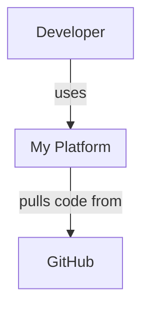
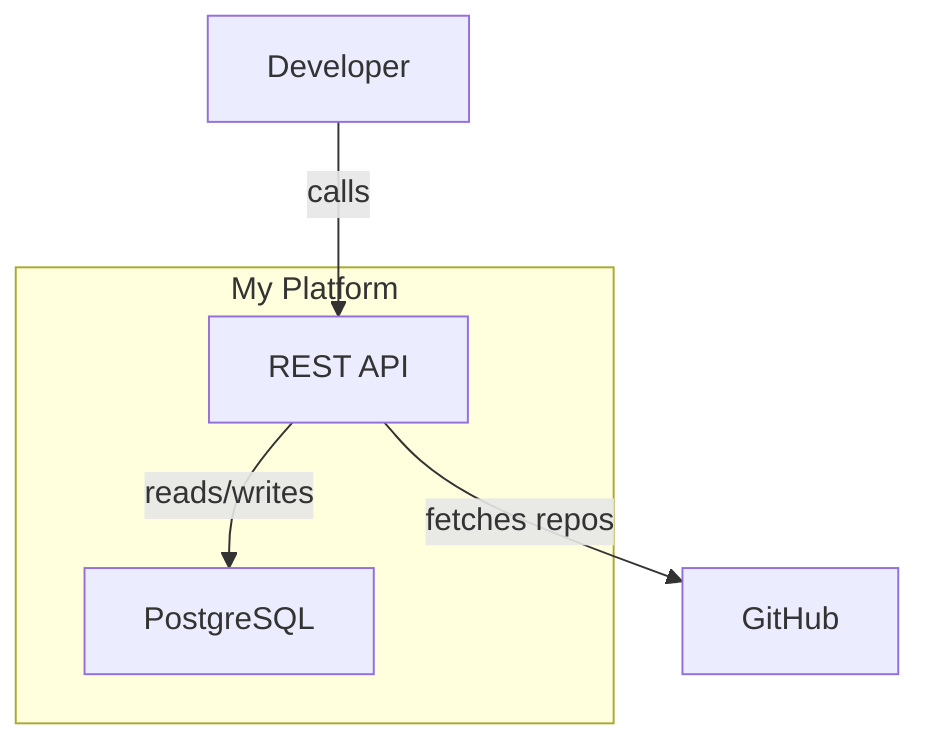

# Decreen Analyze

Analyze the current repository, generate a **Decreen architecture preview**, POST it to the Decreen API, and return an interactive viewer link.

No signup, no token, no local tooling required.

## When to use

- User runs `/decreen-analyze`
- User asks for an architecture map or diagram link
- User wants to visualize services, modules, APIs, databases from the repo

For evidence sidecar + richer provenance capture, use [`/decreen-analyze2`](../decreen-analyze2/SKILL.md).

## Flow

```text
1. Analyze repo (code, configs, manifests)
2. Generate one Mermaid markdown artifact (L1 + L2 + optional L3 + Containment Map)
3. POST to Decreen API (/from-mermaid)
4. Return viewer_url to user
```

## Artifact contract

This skill produces one agent-facing artifact: a markdown string containing Mermaid diagrams and a Containment Map.

| You produce | Server derives (do not hand-author) |
|-------------|-------------------------------------|
| Mermaid L1/L2/L3 diagrams | `nodes`, `edges`, URNs |
| `## Containment Map` with `parentToChildren` / `childToParent` | `explicit_containment.tree`, `child_to_parent_local`, `containment.subgraphs` |

**Endpoint:** `POST {DECREEN_API}/api/v0/local-architecture-preview/from-mermaid`

**Request body:**

```json
{
  "repo": { "fullName": "owner/repo", "commitSha": "...", "branch": "main", "remote": "..." },
  "artifact": { "format": "decreen-c4-mermaid-markdown", "content": "<THE FULL MARKDOWN ARTIFACT>" },
  "source": "cursor-decreen-analyze"
}
```

### Invariants

- Output is one markdown string — not seed JSON.
- The only structured JSON inside that string is the **Containment Map** section (`parentToChildren` / `childToParent`).
- The skill produces only the Mermaid markdown artifact. Decreen derives all internal graph structures server-side.
- On failure, fix **Mermaid diagrams** and the **Containment Map** — not internal seed shape.
- Do not construct raw graph payloads. Use only the `/from-mermaid` endpoint for this skill.

## Prerequisites

| Variable | Required | Default |
|----------|----------|---------|
| `DECREEN_API` | No | `https://api.decreen.com` |

No token needed for preview mode. Map expires after 7 days unless claimed.

---

## Step 1: Resolve repo context

```bash
git rev-parse HEAD              # commitSha
git rev-parse --abbrev-ref HEAD # branch
git remote get-url origin       # remote (may be empty for local-only repos)
```

Derive `owner/repo` from the remote. If no remote, use `local/<directory-name>`.

Default to the whole repository. Ask for scope only if the repository is clearly a monorepo with multiple unrelated applications.

## Step 2: Analyze and generate Mermaid artifact

Analyze in **four passes** (do not stop between them):

### Pass 1 — Runtime inventory
Identify actors, runtime externals, deployable systems. Use runtime evidence as the source of truth (code, manifests, Docker, CI). Docs may help naming and intent, but do not invent systems from prose alone.

### Pass 2 — L2 containers
Define the system boundary. Identify containers inside it (services, databases, queues, frontends). Do not model test files, generated files, config-only files, build scripts, or one-off tools as containers.

### Pass 3 — L3 selection (optional)
Select up to 4 containers worth expanding. Each should have ≥2 of: API surface, processing logic, state/persistence, routing/middleware. Do not model test files, generated files, or config-only files as components unless they are runtime entrypoints.

### Pass 4 — Render
Write the final Mermaid artifact. No new architecture — render only.

### Output format

The artifact is **one markdown string** containing:

1. **L1 System Context** — actors + system boundary + externals
2. **L2 Container Diagram** — all containers inside the boundary
3. **L3 diagrams** (optional, max 4) — components inside selected containers
4. **`## Containment Map`** — mandatory JSON section

Keep the artifact concise. Prefer representative L3 diagrams over exhaustive file-level graphs.

---

## Mermaid format rules

### Labels
Plain human-readable text only. No prefixes in labels.

```
spa["React SPA"]          ✓
spa["container:spa"]      ✗
```

### IDs

Use stable, human-readable local IDs.

Rules:
- Use consistent lowercase IDs (`snake_case` preferred)
- Keep the same ID for the same entity across L1, L2, and L3
- Do not include repo names, file paths, C4 type prefixes, or URNs in IDs
- Do not rename IDs between diagrams for stylistic reasons

Good: `api`, `web_app`, `billing_service`, `postgres`

Avoid: `container_api`, `urn:c4:container:api`, `acme_platform_api`, `src_services_billing_index_ts`

### Semantic markers
Place `%% SEMANTIC: <kind>` above nodes/subgraphs in every diagram where they appear.

Allowed: `actor`, `external`, `system`, `container`, `component`.

### L3 scope
Each L3 diagram needs:
```
%% SCOPE: urn:c4:container:<local_id>
%% SEMANTIC: container
subgraph local_id["Container Name"]
  ...
end
```

### Structure
- L1: system boundary as subgraph (may be empty — edges target subgraph directly)
- L2: system subgraph contains all containers
- L3: container subgraph contains components

### Containment Map (mandatory)

Exact heading: `## Containment Map`

This is the **only** JSON the agent authors. Use `parentToChildren` / `childToParent` — not flat `parent_local_id` trees (that is server-internal).

```json
{
  "parentToChildren": {
    "system_boundary": ["frontend", "backend", "database"]
  },
  "childToParent": {
    "frontend": "system_boundary",
    "backend": "system_boundary",
    "database": "system_boundary"
  }
}
```

Rules:
- IDs match Mermaid node/subgraph local IDs exactly
- Include every system, container, and component that should appear in the hierarchy
- One entry per parent→children group; use multiple parents for nested containment (e.g. `platform` → containers, `api` → components)
- `childToParent` must be consistent with `parentToChildren`
- Actors and externals appear in L1 diagrams; include them in containment only when they belong under a parent (most L1 participants stay outside the system subgraph)

---

## Example artifact (minimal)

````markdown




## Containment Map

```json
{
  "parentToChildren": {
    "platform": ["api", "db"]
  },
  "childToParent": {
    "api": "platform",
    "db": "platform"
  }
}
```
````

---

## Step 3: Upload

Construct the request JSON **in the agent/runtime** (do not rely on shell heredoc for variable expansion or markdown escaping).

1. Set `API` to `${DECREEN_API:-https://api.decreen.com}`.
2. Fill `repo.fullName`, `repo.commitSha`, `repo.branch`, `repo.remote` from Step 1.
3. Set `artifact.content` to the full markdown artifact as a **properly JSON-escaped string**.
4. POST with `curl` or an HTTP client.

```bash
API="${DECREEN_API:-https://api.decreen.com}"

curl -sS -X POST "${API}/api/v0/local-architecture-preview/from-mermaid" \
  -H "Content-Type: application/json" \
  -d @/path/to/request.json
```

Write `/path/to/request.json` with valid JSON — e.g. via a small script or the agent's JSON serializer. **Do not** use a single-quoted heredoc expecting `$VAR` expansion inside the JSON body.

### Response (201)

```json
{
  "kind": "local_architecture_preview",
  "workspace_id": "...",
  "viewer_url": "https://app.decreen.com/embed/explore/workspace/UUID",
  "expires_at": "2026-05-31T...",
  "claim_available": true,
  "node_count": 12,
  "edge_count": 8,
  "warnings": []
}
```

## Step 4: Present to user

1. **Link** — use `viewer_url` from the API response as a clickable markdown link
2. **Summary** — node/edge counts, commit SHA, scope
3. **Overview** — main systems/containers discovered
4. **Conversion CTA** — this is a **temporary preview**. Include the **claim link** (see Step 5 `claimUrl`). Tell the user:

   > This map is temporary. To keep and deepen it:
   > 1. Claim it in Decreen: `<claimUrl>`
   > 2. Install Decreen agent support in your repo:
   >
   >    `npx -y @decreen/local init`
   >
   >    (Monorepo / pre-publish: `node packages/decreen-local/dist/cli.js init`)
   >
   > 3. Then in Cursor: `/decreen-deepen <area>`

---

## Step 5: Write local manifest (optional pointer)

After a successful **201**, write [`.decreen/manifest.json`](../../.decreen/manifest.json) (gitignored local state). Do **not** overwrite [`.decreen/config.json`](../../.decreen/config.json).

Derive app origin from `viewer_url` (scheme + host). Build:

```text
claimUrl = {origin}/claim-preview/{workspaceId}?intent=deepen&next=/w/{workspaceId}/diagrams?view=facet%3Ac4
```

Canonical claim route in this repo: [`/claim-preview/:workspaceId`](../../frontend/src/Routes.jsx) (handles sign-in redirect, then claim POST).

```json
{
  "version": 1,
  "repo": {
    "provider": "github",
    "fullName": "owner/repo",
    "defaultBranch": "main",
    "remote": "..."
  },
  "decreen": {
    "workspaceId": "<workspace_id from response>",
    "publicExploreUrl": "<viewer_url with /embed/ removed>",
    "embedUrl": "<viewer_url from response>",
    "claimUrl": "<origin>/claim-preview/<workspaceId>?intent=deepen&next=/w/<workspaceId>/diagrams?view=facet%3Ac4",
    "workspaceLifecycle": "temporary_preview",
    "expiresAt": "<expires_at from response>",
    "claimAvailable": true
  },
  "analysis": {
    "lastCommitSha": "<commit from Step 1>",
    "lastAnalyzedAt": "<ISO8601 now>",
    "nodeCount": "<node_count>",
    "edgeCount": "<edge_count>"
  }
}
```

Rules:

- Always set `workspaceLifecycle` to `"temporary_preview"` for this anonymous `/from-mermaid` flow.
- Always set `claimUrl` for temporary previews (deepen skill uses it for conversion CTA).
- If manifest exists with a different `workspaceId`, warn before overwrite.
- Do not tell the user that `/decreen-deepen` is available yet — it requires claim first.

### After user claims the map

When the user claims via [`/claim-preview/:workspaceId`](../../frontend/src/pages/ClaimLocalPreviewPage.tsx), update local manifest:

- `workspaceLifecycle`: `"persistent"`
- `claimedAt`: ISO timestamp
- `expiresAt`: `null`
- `claimAvailable`: `false`
- `workspaceUrl`: from claim response (`workspaceUrl` or `diagramsUrl` — `/w/{id}/diagrams?view=facet%3Ac4`)
- Remove `claimUrl`, `publicExploreUrl`, `embedUrl`, legacy `exploreUrl` (persistent uses authenticated route only)

See [`.decreen/README.md`](../../.decreen/README.md) and [`.decreen/manifest.persistent.example.json`](../../.decreen/manifest.persistent.example.json).

---

## Error handling

| Status | Meaning |
|--------|---------|
| 400 | No diagrams found, missing Containment Map, invalid containment, or artifact too large (>500KB markdown) |
| 429 | Rate limit exceeded — wait and retry |
| 500 | Server-side parse/publish failure — check `warnings`, fix Mermaid, retry |

On 400 with `NO_DIAGRAMS`: add valid `graph TB` / `flowchart` Mermaid blocks.

On 400 mentioning containment: fix the `## Containment Map` section — IDs, parent/child consistency, missing hierarchy entries.

On empty or wrong diagram after 201: regenerate the Mermaid artifact with stronger containment coverage and consistent cross-level IDs, then retry.

---

## Non-goals

- No hand-authored seed JSON — server parses Mermaid
- No raw-seed endpoint in the default flow
- No local import tooling required
- No API token for preview mode
- Do not commit generated artifacts unless the user asks
