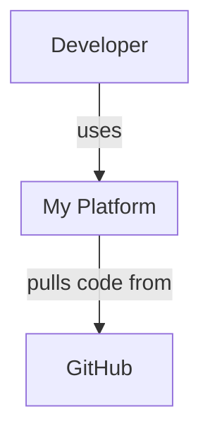
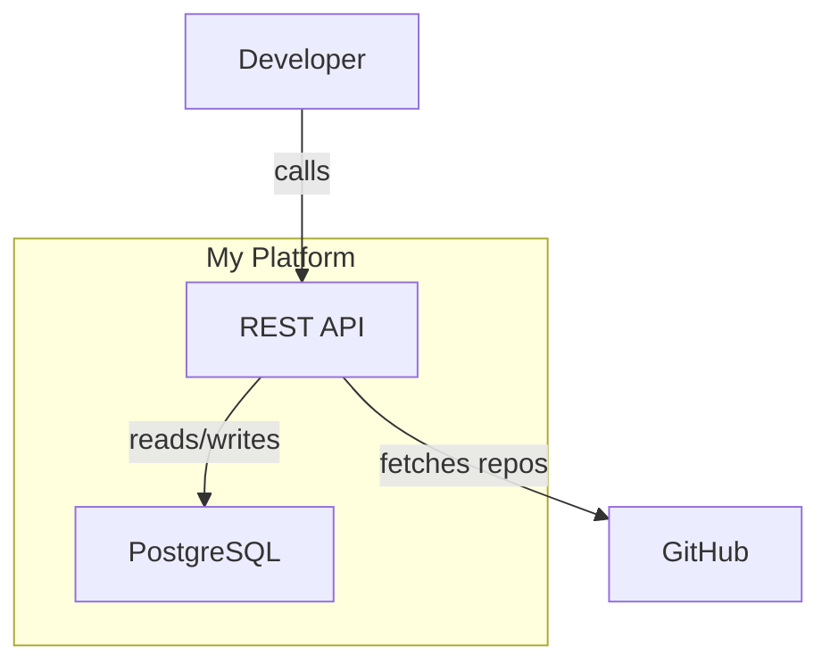
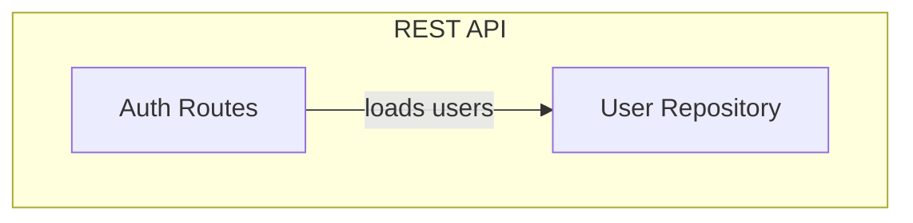

# Decreen Analyze 2

Analyze the current repository, generate a **Decreen architecture preview**, POST it to the Decreen API, and return an interactive viewer link.

No signup, no token, no local tooling required.

The uploaded preview contains only the Mermaid artifact accepted by Decreen. Source-code evidence is written locally as a sidecar file for later matching against CGC/code graph context after the map is claimed.

## When to use

* User runs `/decreen-analyze2`
* User asks for an architecture map or diagram link
* User wants to visualize services, modules, APIs, databases from the repo

## Flow

```text
1. Analyze repo (code, configs, manifests)
2. Generate one Mermaid markdown artifact (L1 + L2 + optional L3 + Containment Map)
3. Generate local source-evidence sidecar JSON
4. POST only the Mermaid markdown artifact to Decreen API (/from-mermaid)
5. Write local manifest with preview metadata and sidecar pointer
6. Return viewer_url to user
```

## Artifact contract

This skill produces one agent-facing artifact for upload: a markdown string containing Mermaid diagrams and a Containment Map.

It also writes one local sidecar file containing source-code evidence. The sidecar is **not** embedded in the uploaded artifact and is **not** posted to `/from-mermaid`.

| You produce                                                    | Server derives / uses                                                         |
| -------------------------------------------------------------- | ----------------------------------------------------------------------------- |
| Mermaid L1/L2/L3 diagrams                                      | `nodes`, `edges`, URNs                                                        |
| `## Containment Map` with `parentToChildren` / `childToParent` | `explicit_containment.tree`, `child_to_parent_local`, `containment.subgraphs` |
| `.decreen/runs/latest.source-evidence.json` local sidecar      | later local CGC/code graph reconciliation after claim                         |

**Endpoint:** `POST {DECREEN_API}/api/v0/local-architecture-preview/from-mermaid`

**Request body:**

```json
{
  "repo": { "fullName": "owner/repo", "commitSha": "...", "branch": "main", "remote": "..." },
  "artifact": { "format": "decreen-c4-mermaid-markdown", "content": "<THE FULL MARKDOWN ARTIFACT>" },
  "source": "cursor-decreen-analyze2"
}
```

### Invariants

* Uploaded artifact is one markdown string — not seed JSON.
* The only structured JSON inside the uploaded markdown artifact is the **Containment Map** section (`parentToChildren` / `childToParent`).
* Source evidence is written only to `.decreen/runs/latest.source-evidence.json`.
* Source evidence is not embedded in `artifact.content`.
* Source evidence is not posted to `/from-mermaid`.
* The skill produces only the Mermaid markdown artifact for upload. Decreen derives all internal graph structures server-side.
* On preview upload failure, fix **Mermaid diagrams** and the **Containment Map** — not internal seed shape.
* Do not construct raw graph payloads. Use only the `/from-mermaid` endpoint for this skill.
* Architecture IDs stay clean and stable. Do not put file paths, repo names, C4 prefixes, or URNs into Mermaid IDs.
* Source paths, symbols, routes, and evidence reasons belong only in the local source-evidence sidecar.

## Prerequisites

| Variable      | Required | Default                   |
| ------------- | -------- | ------------------------- |
| `DECREEN_API` | No       | `https://api.decreen.com` |

No token needed for preview mode. Map expires after 7 days unless claimed.

---

## Step 1: Resolve repo context

```bash
git rev-parse HEAD              # commitSha
git rev-parse --abbrev-ref HEAD # branch
git remote get-url origin       # remote (may be empty for local-only repos)
```

Derive `owner/repo` from the remote. If no remote, use `local/<directory-name>`.

Default to the whole repository. Ask for scope only if the repository is clearly a monorepo with multiple unrelated applications.

---

## Step 2: Analyze repo

Analyze in **five passes**. Do not stop between them.

### Pass 1 — Runtime inventory

Identify actors, runtime externals, deployable systems, and true runtime entrypoints.

Use runtime evidence as the source of truth:

* code
* manifests
* package scripts
* Dockerfiles
* CI config
* route declarations
* queue/worker declarations
* database schemas
* app/server bootstraps
* CLI binaries

Docs may help naming and intent, but do not invent systems from prose alone.

### Pass 2 — L2 containers

Define the system boundary. Identify containers inside it:

* services
* frontends
* APIs
* databases
* queues
* workers
* CLIs
* durable runtimes

Do not model test files, generated files, config-only files, build scripts, or one-off tools as containers unless they are runtime entrypoints.

### Pass 3 — L3 selection

Select up to 4 containers worth expanding.

Each selected container should have at least 2 of:

* API surface
* processing logic
* state/persistence
* routing/middleware
* queue/event handling
* runtime orchestration

Do not model test files, generated files, or config-only files as components unless they are runtime entrypoints.

### Pass 4 — Source evidence capture

For every system/container/component and important edge, record source-code evidence in memory so it can be written later to `.decreen/runs/latest.source-evidence.json`.

Evidence should explain **why this architecture element exists**.

Rules:

1. Every container should have at least one evidence item.
2. Every L3 component should have at least one evidence item.
3. Edges should have evidence when possible.
4. Prefer `path + symbol` over `path` only.
5. Prefer concrete runtime evidence over naming guesses.
6. Do not quote full source code.
7. Do not include large snippets.
8. Do not invent evidence to make the diagram prettier.
9. Do not include test/generated/build files unless they are runtime entrypoints.
10. If evidence is weak, set `confidence` below `0.6` or omit the element.

Good evidence examples:

* `src/server/app.ts` configures Express routes
* `src/server/routes/auth.ts` defines auth endpoints
* `src/workers/RepoAnalysisWorker.ts` consumes `repoAnalysis`
* `prisma/schema.prisma` defines persistence model
* `src/client/api/billingClient.ts` calls billing API
* `package.json` declares CLI binary
* `Dockerfile` defines deployable runtime

Bad evidence examples:

* “Looks like a backend”
* “Probably handles users”
* “Mentioned in README only”
* “The name sounds like billing”

### Pass 5 — Render

Write the final Mermaid artifact. No new architecture after this pass — render only.

---

## Step 3: Generate Mermaid artifact

The uploaded artifact is **one markdown string** containing:

1. **L1 System Context** — actors + system boundary + externals
2. **L2 Container Diagram** — all containers inside the boundary
3. **L3 diagrams** — optional, max 4
4. **`## Containment Map`** — mandatory JSON section

Do **not** include source evidence in the markdown artifact.

Keep the artifact concise. Prefer representative L3 diagrams over exhaustive file-level graphs.

---

## Mermaid format rules

### Labels

Plain human-readable text only. No prefixes in labels.

```text
spa["React SPA"]          ✓
spa["container:spa"]      ✗
```

### IDs

Use stable, human-readable local IDs.

Rules:

* Use consistent lowercase IDs (`snake_case` preferred)
* Keep the same ID for the same entity across L1, L2, and L3
* Do not include repo names, file paths, C4 type prefixes, or URNs in IDs
* Do not rename IDs between diagrams for stylistic reasons

Good:

```text
api
web_app
billing_service
postgres
repo_analysis_worker
```

Avoid:

```text
container_api
urn:c4:container:api
acme_platform_api
src_services_billing_index_ts
```

### Semantic markers

Place `%% SEMANTIC: <kind>` above nodes/subgraphs in every diagram where they appear.

Allowed:

```text
actor
external
system
container
component
```

### L3 scope

Each L3 diagram needs:

```text
%% SCOPE: urn:c4:container:<local_id>
%% SEMANTIC: container
subgraph local_id["Container Name"]
  ...
end
```

### Structure

* L1: system boundary as subgraph. It may be empty; edges may target the subgraph directly.
* L2: system subgraph contains all containers.
* L3: container subgraph contains components.

---

## Containment Map

Exact heading:

```markdown
## Containment Map
```

This section is mandatory.

This is the **only** JSON embedded inside the uploaded markdown artifact.

Use `parentToChildren` / `childToParent` — not flat `parent_local_id` trees.

```json
{
  "parentToChildren": {
    "platform": ["frontend", "backend", "database"],
    "backend": ["auth_component", "billing_component"]
  },
  "childToParent": {
    "frontend": "platform",
    "backend": "platform",
    "database": "platform",
    "auth_component": "backend",
    "billing_component": "backend"
  }
}
```

Rules:

* IDs match Mermaid node/subgraph local IDs exactly.
* Include every system, container, and component that should appear in the hierarchy.
* One entry per parent→children group.
* Use multiple parents for nested containment, for example `platform → containers`, `api → components`.
* `childToParent` must be consistent with `parentToChildren`.
* Actors and externals appear in L1 diagrams; include them in containment only when they belong under a parent. Most L1 participants stay outside the system subgraph.

---

## Source evidence sidecar

In addition to the Mermaid artifact, create a local JSON sidecar file:

```text
.decreen/runs/latest.source-evidence.json
```

Do not embed this JSON in `artifact.content`.

Do not POST this JSON to `/from-mermaid`.

The sidecar records source evidence for Mermaid node IDs and edge IDs.

### Sidecar schema

```json
{
  "schemaVersion": "decreen.sourceEvidence.v1",
  "repo": {
    "fullName": "owner/repo",
    "commitSha": "...",
    "branch": "main",
    "remote": "..."
  },
  "artifact": {
    "format": "decreen-c4-mermaid-markdown",
    "mapLocalIds": true
  },
  "nodes": {
    "api": [
      {
        "kind": "file",
        "path": "src/server/app.ts",
        "symbol": "optionalSymbolName",
        "reason": "Configures the backend HTTP server and route mounting.",
        "confidence": 0.9
      }
    ]
  },
  "edges": {
    "web_app->api": [
      {
        "kind": "file",
        "path": "src/client/api/authClient.ts",
        "reason": "Frontend client calls backend API endpoints.",
        "confidence": 0.82
      }
    ]
  }
}
```

### Evidence item schema

Each evidence item may contain:

```json
{
  "kind": "file | directory | function | class | route | config | manifest | database_schema | queue | package | worker | cli | unknown",
  "path": "relative/path/from/repo/root",
  "symbol": "optionalFunctionOrClassName",
  "route": {
    "method": "GET|POST|PUT|PATCH|DELETE|OPTIONAL",
    "path": "/optional/route/path"
  },
  "lineStart": 10,
  "lineEnd": 42,
  "confidence": 0.85,
  "reason": "Why this source item supports the architecture node or edge."
}
```

Rules:

* Use Mermaid local IDs as node keys.
* Use `<from_id>-><to_id>` as edge keys.
* Use relative paths from repo root.
* Prefer paths that can later be matched to CGC `File.relative_path`.
* Prefer symbols that can later be matched to CGC `Function.name`, `Class.name`, or similar.
* Prefer `path + symbol` over `path` only.
* Do not include source code bodies.
* Do not include secrets, tokens, or environment values.
* Do not include huge lists. Use 1–5 strong evidence items per node or edge.
* For uncertain evidence, lower confidence rather than inventing certainty.
* If a node has no source evidence, reconsider whether it should be in the map.
* If an edge has no source evidence but the relationship is architecturally obvious from runtime structure, include the edge with no evidence rather than inventing evidence.

---

## Example uploaded artifact

````markdown






## Containment Map

```json
{
  "parentToChildren": {
    "platform": ["api", "db"],
    "api": ["auth_routes", "user_repository"]
  },
  "childToParent": {
    "api": "platform",
    "db": "platform",
    "auth_routes": "api",
    "user_repository": "api"
  }
}
```
````

---

## Example local source-evidence sidecar

Write this to:

```text
.decreen/runs/latest.source-evidence.json
```

```json
{
  "schemaVersion": "decreen.sourceEvidence.v1",
  "repo": {
    "fullName": "owner/repo",
    "commitSha": "abc123",
    "branch": "main",
    "remote": "git@github.com:owner/repo.git"
  },
  "artifact": {
    "format": "decreen-c4-mermaid-markdown",
    "mapLocalIds": true
  },
  "nodes": {
    "api": [
      {
        "kind": "file",
        "path": "src/server/app.ts",
        "reason": "Configures the backend API server.",
        "confidence": 0.88
      }
    ],
    "db": [
      {
        "kind": "database_schema",
        "path": "prisma/schema.prisma",
        "reason": "Defines the PostgreSQL-backed data model.",
        "confidence": 0.9
      }
    ],
    "auth_routes": [
      {
        "kind": "function",
        "path": "src/server/routes/auth.ts",
        "symbol": "registerAuthRoutes",
        "reason": "Registers authentication-related API routes.",
        "confidence": 0.93
      }
    ],
    "user_repository": [
      {
        "kind": "file",
        "path": "src/server/repositories/UserRepository.ts",
        "reason": "Encapsulates user persistence access.",
        "confidence": 0.87
      }
    ]
  },
  "edges": {
    "api->db": [
      {
        "kind": "file",
        "path": "src/server/repositories/UserRepository.ts",
        "reason": "Repository code performs database access on behalf of the API.",
        "confidence": 0.82
      }
    ],
    "auth_routes->user_repository": [
      {
        "kind": "function",
        "path": "src/server/routes/auth.ts",
        "symbol": "registerAuthRoutes",
        "reason": "Auth routes delegate user lookup to the repository layer.",
        "confidence": 0.78
      }
    ]
  }
}
```

---

## Step 4: Upload

Construct the request JSON **in the agent/runtime**. Do not rely on shell heredoc for variable expansion or markdown escaping.

1. Set `API` to `${DECREEN_API:-https://api.decreen.com}`.
2. Fill `repo.fullName`, `repo.commitSha`, `repo.branch`, `repo.remote` from Step 1.
3. Set `artifact.content` to the full markdown artifact as a properly JSON-escaped string.
4. POST with `curl` or an HTTP client.

```bash
API="${DECREEN_API:-https://api.decreen.com}"

curl -sS -X POST "${API}/api/v0/local-architecture-preview/from-mermaid" \
  -H "Content-Type: application/json" \
  -d @/path/to/request.json
```

Write `/path/to/request.json` with valid JSON, for example via a small script or the agent's JSON serializer.

Do not use a single-quoted heredoc expecting `$VAR` expansion inside the JSON body.

### Response: `201`

```json
{
  "kind": "local_architecture_preview",
  "workspace_id": "...",
  "viewer_url": "https://app.decreen.com/embed/explore/workspace/UUID",
  "expires_at": "2026-05-31T...",
  "claim_available": true,
  "node_count": 12,
  "edge_count": 8,
  "warnings": []
}
```

---

## Step 5: Present to user

Return:

1. **Link** — use `viewer_url` from the API response as a clickable markdown link.
2. **Summary** — node/edge counts, commit SHA, scope.
3. **Overview** — main systems/containers discovered.
4. **Evidence note** — mention that local source evidence was written and can later be matched to CGC/code graph context after claim.
5. **Conversion CTA** — this is a temporary preview. Include the claim link from Step 6.

Tell the user:

```text
This map is temporary. To keep and deepen it:

1. Claim it in Decreen: <claimUrl>
2. Install Decreen agent support in your repo:

   npx -y @decreen/local init

   Monorepo / pre-publish:
   node packages/decreen-local/dist/cli.js init

3. Then in Cursor: /decreen-deepen <area>
```

Do not tell the user that `/decreen-deepen` is available before claim.

---

## Step 6: Write local manifest

After a successful `201`, write `.decreen/manifest.json` as gitignored local state.

Do not overwrite `.decreen/config.json`.

Derive app origin from `viewer_url`, using scheme + host.

Build:

```text
claimUrl = {origin}/claim-preview/{workspaceId}?intent=deepen&next=/w/{workspaceId}/diagrams?view=facet%3Ac4
```

Canonical claim route:

```text
/claim-preview/:workspaceId
```

Manifest:

```json
{
  "version": 1,
  "repo": {
    "provider": "github",
    "fullName": "owner/repo",
    "defaultBranch": "main",
    "remote": "..."
  },
  "decreen": {
    "workspaceId": "<workspace_id from response>",
    "publicExploreUrl": "<viewer_url with /embed/ removed>",
    "embedUrl": "<viewer_url from response>",
    "claimUrl": "<origin>/claim-preview/<workspaceId>?intent=deepen&next=/w/<workspaceId>/diagrams?view=facet%3Ac4",
    "workspaceLifecycle": "temporary_preview",
    "expiresAt": "<expires_at from response>",
    "claimAvailable": true
  },
  "analysis": {
    "lastCommitSha": "<commit from Step 1>",
    "lastAnalyzedAt": "<ISO8601 now>",
    "nodeCount": "<node_count>",
    "edgeCount": "<edge_count>",
    "sourceEvidencePath": ".decreen/runs/latest.source-evidence.json"
  }
}
```

Rules:

* Always set `workspaceLifecycle` to `"temporary_preview"` for this anonymous `/from-mermaid` flow.
* Always set `claimUrl` for temporary previews.
* Always set `analysis.sourceEvidencePath` if the source-evidence sidecar was written.
* If manifest exists with a different `workspaceId`, warn before overwrite.
* Do not commit generated artifacts unless the user asks.

### After user claims the map

When the user claims via `/claim-preview/:workspaceId`, update local manifest:

* `workspaceLifecycle`: `"persistent"`
* `claimedAt`: ISO timestamp
* `expiresAt`: `null`
* `claimAvailable`: `false`
* `workspaceUrl`: from claim response, preferably `/w/{id}/diagrams?view=facet%3Ac4`
* Preserve `analysis.sourceEvidencePath`
* Remove `claimUrl`, `publicExploreUrl`, `embedUrl`, legacy `exploreUrl`

Persistent workspaces use authenticated routes only.

---

## Error handling

| Status | Meaning                                                                                |
| ------ | -------------------------------------------------------------------------------------- |
| 400    | No diagrams found, missing Containment Map, invalid containment, or artifact too large |
| 429    | Rate limit exceeded — wait and retry                                                   |
| 500    | Server-side parse/publish failure — check `warnings`, fix Mermaid/maps, retry          |

On `400` with `NO_DIAGRAMS`:

* Add valid `graph TB` or `flowchart` Mermaid blocks.

On `400` mentioning containment:

* Fix `## Containment Map`.
* Check IDs.
* Check parent/child consistency.
* Check missing hierarchy entries.

On empty or wrong diagram after `201`:

* Regenerate the Mermaid artifact with stronger containment coverage and consistent cross-level IDs.
* Retry.

If local source-evidence sidecar writing fails:

* Continue with preview upload if the Mermaid artifact is valid.
* Mention that source-evidence sidecar writing failed.
* Do not block the preview on sidecar failure.

---

## Non-goals

* No hand-authored seed JSON.
* No raw-seed endpoint in the default flow.
* No local import tooling required.
* No API token for preview mode.
* Do not commit generated artifacts unless the user asks.
* Do not put file paths into Mermaid IDs.
* Do not include source evidence inside the uploaded Mermaid artifact.
* Do not POST source evidence to `/from-mermaid`.
* Do not include full source code in the source-evidence sidecar.
* Do not use source evidence to invent architecture that is not visible in runtime evidence.
